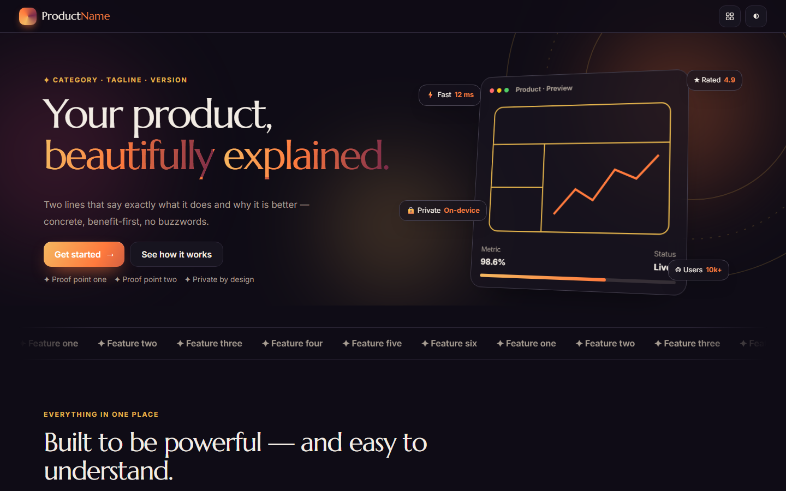
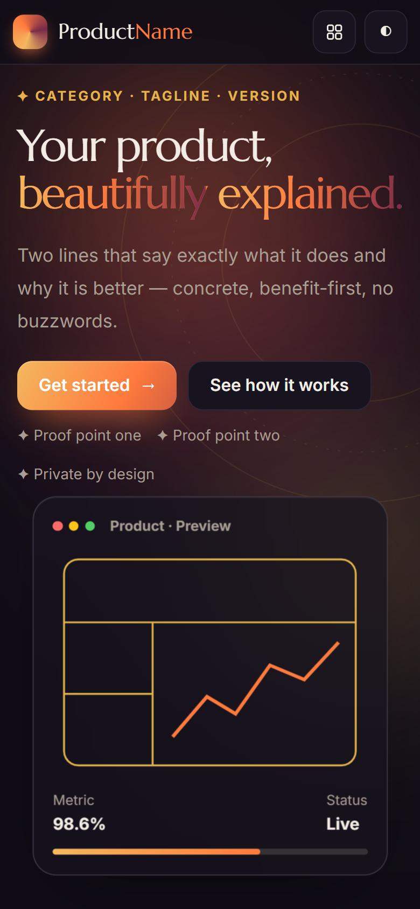

<div align="center">

<br>



<br>
<br>

# ✨ Websites Templates & Skills

### Premium, scroll‑animated website templates — packaged as reusable **Claude Code skills**

Drop a skill into your machine (or any repo), ask for a page, and get a modern, glassy, motion‑rich website in minutes — not a flat, static page from 2015.

<br>

[](LICENSE)
[](#-install)
[](https://gsap.com)
[](#-use-it-without-claude)
[](#-accessibility--performance)

<br>

**[🚀 Live demo](https://kundali.arvind.eu.org/)** &nbsp;·&nbsp; **[📦 Install](#-install)** &nbsp;·&nbsp; **[🧑‍💻 Usage](#-usage)** &nbsp;·&nbsp; **[🎨 Customize](#-customize)** &nbsp;·&nbsp; **[📄 License](#-license)**

<br>

</div>

---

<br>

## 🌟 What's inside

<br>

| Skill | What it builds | Highlights |
| :-- | :-- | :-- |
| 🌌 **`animated-landing`** | Landing / welcome / marketing pages and product home pages | Aurora glows · glass cards · word‑by‑word headlines · pinned scroll tour · 3D card fan · CTA band that expands into a form · menu dropdown · light & dark |

> 🧩 More templates will be added here as new folders under [`skills/`](skills) — each one is self‑contained and installs the same way.

<br>

## 🎬 Features

<br>

<table>
<tr>
<td width="33%" valign="top">

### 🌌 Look
- Aurora colour blobs & rotating orbit
- Frosted **glass** cards with gradient hairlines
- Big display type with **gradient** words
- Glowing gradient CTAs
- 3D tilted product card + floating chips

</td>
<td width="33%" valign="top">

### 🎞️ Motion
- Word‑by‑word headline reveal
- Fade‑and‑rise sections with stagger
- **Pinned tour** — sticky visual, scrolling steps
- **3D card fan** scrubbed by scroll
- Marquee strip · count‑up stats · scroll progress bar

</td>
<td width="33%" valign="top">

### 🧠 Smart UX
- **One** “Begin” band that expands into the form
- Two flows in one card via a **mode switch**
- Minimal header + glass **menu dropdown**
- Full‑width desktop, tidy mobile
- Light / dark themes from design tokens

</td>
</tr>
</table>

<br>

## 📸 Preview

<br>

<table>
<tr>
<td width="68%" align="center"><br><sub>🖥️ Desktop — hero, 3D product card, floating chips, marquee</sub></td>
<td width="32%" align="center"><br><sub>📱 Mobile — same design, stacked</sub></td>
</tr>
</table>

<p align="center">👉 See the full experience with real content on the <b><a href="https://kundali.arvind.eu.org/">live demo</a></b> — scroll slowly to feel the motion.</p>

<br>

## 📦 Install

<br>

<details open>
<summary><b>🪟 Windows (PowerShell)</b></summary>

<br>

```powershell
git clone https://github.com/Arvind0099/websites-templates-skills.git
cd websites-templates-skills
powershell -ExecutionPolicy Bypass -File .\install.ps1
```

This copies every skill into `%USERPROFILE%\.claude\skills\` so it is available in **all** your projects.

</details>

<details open>
<summary><b>🍎 macOS / 🐧 Linux</b></summary>

<br>

```bash
git clone https://github.com/Arvind0099/websites-templates-skills.git
cd websites-templates-skills
sh install.sh
```

This copies every skill into `~/.claude/skills/`.

</details>

<details>
<summary><b>👥 One project only (shared with your team / cloud sessions)</b></summary>

<br>

```powershell
# Windows
.\install.ps1 -Project "C:\path\to\your-project"
```

```bash
# macOS / Linux
sh install.sh --project /path/to/your-project
```

The skill lands in `<your-project>/.claude/skills/` — commit it and everyone who opens that repo gets it.

</details>

<details>
<summary><b>✋ Manual install</b></summary>

<br>

Copy the folder [`skills/animated-landing`](skills/animated-landing) into either:

| Scope | Location |
| :-- | :-- |
| 🌍 All projects on this computer | `~/.claude/skills/animated-landing/` &nbsp;(Windows: `%USERPROFILE%\.claude\skills\animated-landing\`) |
| 📁 A single project | `<project>/.claude/skills/animated-landing/` |

</details>

> ✅ Open a **new** Claude Code session after installing — skills are picked up automatically, no settings needed.

<br>

## 🧑‍💻 Usage

<br>

Open any project in Claude Code and use **one** of these:

| Way | Example |
| :-- | :-- |
| ⚡ **Slash command** | `/animated-landing build the landing page for my pastebin app` |
| 💬 **Ask by name** | “Use my **animated-landing** template for this site.” |
| 🔁 **Point to the reference** | “Same design as Kundali Pro.” |
| 🪄 **Just describe it** | “Make a modern landing page for my SaaS.” — the skill is matched automatically |

<br>

**What happens next** 👇

1. 📂 The starter files (`index.html`, `styles.css`, `motion.js`) are copied into your project.
2. 🎨 Colours, fonts, copy, icons and the hero product card are rebranded for your product.
3. 🧱 The house rules are kept — one Begin band at the end, sibling flows behind a switch, secondary pages in the menu, reduced‑motion support.

<br>

## 🧩 Use it without Claude

<br>

It's plain HTML/CSS/JS — no framework, no build step.

```text
skills/animated-landing/template/
├── index.html   ← open this in a browser
├── styles.css   ← design tokens + components
└── motion.js    ← reveals, tour, fan, menu, Begin band
```

Copy those three files anywhere, open `index.html`, and start replacing the placeholder text. GSAP + ScrollTrigger load from cdnjs; if they're blocked, the page still works (only the scroll‑scrubbed extras are skipped).

<br>

## 🎨 Customize

<br>

Everything brand‑related lives at the top of `styles.css`:

| Token | Purpose | Default |
| :-- | :-- | :-- |
| `--brand-1` | Gradient start (light) |  `#f4b860` |
| `--brand-2` | Gradient middle (main) |  `#ff7a3d` |
| `--brand-3` | Gradient end (deep) |  `#7a2a4a` |
| `--accent` | Links, active states |  `#ff7a3d` |
| `--gold` | Eyebrows, lines, borders |  `#e3b34c` |
| `--bg` / `--surface` / `--ink` | Base, cards, text (dark & light sets) | navy‑plum dark theme |
| `--font` / `--display` | Body / display fonts | Inter / Marcellus |

<br>

**Building blocks you can mix & match**

| Block | Class / id | Tip |
| :-- | :-- | :-- |
| 🦸 Hero + 3D card | `.hero`, `.hv-card`, `.fchip` | Put a screenshot or SVG of your product inside `.hv-card` |
| 🧾 Feature grid | `.f-grid`, `.f-card` | 4 / 2 / 1 columns responsive; icons draw in on reveal |
| 📌 Pinned tour | `.tour`, `.tour-visual[data-step]`, `.tour-step` | Add a `.tv-pN` panel per step |
| 🃏 3D fan | `.fan`, `.fan-card` | Set `--i` / `--n` on each card |
| 🔢 Stats | `.stat [data-count]` | Use `data-suffix="+"` or `"%"` |
| 🚪 Begin band | `#begin`, `.mode-switch`, `.mode-pane` | Any `[data-act="start"]` opens it; `data-mode` picks a pane |

<br>

## 🧠 Design rules baked into the skill

<br>

- 🎯 **Exactly one Begin band**, at the end of the page — every CTA scrolls to it and expands it into the form.
- 🔀 **Two primary flows share one card** behind a segmented switch — the visitor chooses.
- 🧭 **Header stays minimal** — brand left, menu + tools right; extra pages live in the menu and footer.
- 🖥️ **Use the full desktop width** for app/dashboard views.
- 🫥 **Results replace marketing** — once the user has an outcome, hide the hero and landing.

<br>

## ♿ Accessibility & performance

<br>

| | |
| :-- | :-- |
| 🧘 | `prefers-reduced-motion` turns off parallax, fan, marquee and blob animation |
| 🚫📜 | Content is fully visible with JavaScript disabled |
| 🛟 | Reveals use a geometry check + timer fallback, so nothing stays hidden in background tabs or print |
| 👆 | 44 px touch targets, keyboard‑friendly menu (Esc closes), visible focus |
| 🌗 | Light and dark themes via tokens + `prefers-color-scheme` |
| ⚡ | CSS for loops, GSAP only for scroll‑linked work — no images required |

<br>

## 🔄 Updating

<br>

```bash
cd websites-templates-skills
git pull
sh install.sh        # or: powershell -ExecutionPolicy Bypass -File .\install.ps1
```

<br>

## 🗂️ Repository structure

<br>

```text
websites-templates-skills/
├── 📄 README.md
├── ⚖️ LICENSE
├── 🪟 install.ps1
├── 🐧 install.sh
├── 🖼️ assets/                     # README previews
└── 🧩 skills/
    └── 🌌 animated-landing/
        ├── SKILL.md              # design system + rules the assistant follows
        └── template/
            ├── index.html
            ├── styles.css
            └── motion.js
```

<br>

## 🤝 Contributing

<br>

1. 🍴 Fork the repo and create a branch.
2. ➕ Add a new folder in `skills/<your-skill>/` with a `SKILL.md` (front‑matter `name` + `description`) and a `template/`.
3. 🖼️ Add a preview to `assets/` and a row to the **What's inside** table.
4. 📬 Open a pull request.

<br>

## 📄 License

<br>

Released under the **[MIT License](LICENSE)** — use it in personal and commercial projects. GSAP is loaded from cdnjs under its own [standard license](https://gsap.com/standard-license/).

<br>

---

<div align="center">

<br>

### 💛 Crafted with care by [@N4pst3rX](https://t.me/N4pst3rX)

If this saved you time, leave a ⭐ — it helps others find it.

<br>

</div>
